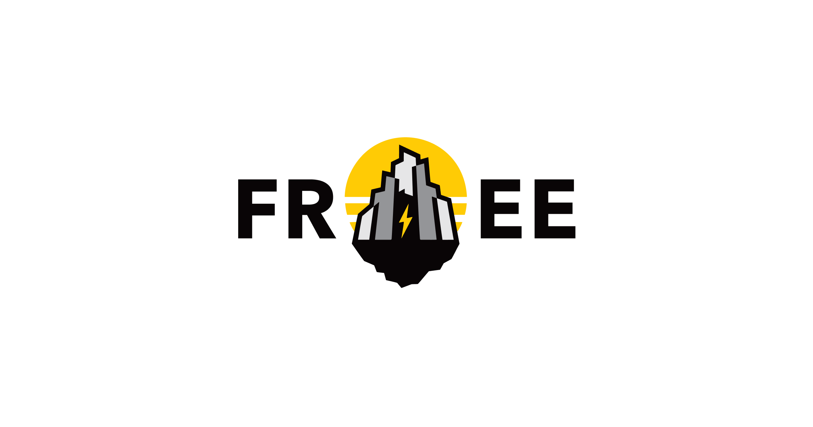

<div align="center">
<h1>FREE Madeira</h1>
</div>

## Getting started

Requirements: [Node](https://nodejs.org/) 24 and [pnpm](https://pnpm.io/installation) 12.

```bash
pnpm install
pnpm dev
```

- FREE Madeira: http://localhost:4321
- Bitcoin Atlantis: http://localhost:4322

How the repository is laid out, how content gets from freehub to the sites, and the conventions are in [AGENTS.md](AGENTS.md).

## Tech stack

- [Astro](https://astro.build/): the sites, prerendered and cached on [Vercel](https://vercel.com/)
- [React](https://react.dev/): interactive islands
- [Tailwind CSS](https://tailwindcss.com/) and [shadcn/ui](https://ui.shadcn.com/) on [Base UI](https://base-ui.com/): styling and components
- [Paraglide JS](https://inlang.com/m/gerre34r/library-inlang-paraglideJs): Portuguese and English messages
- [libSQL](https://github.com/tursodatabase/libsql) and [Drizzle](https://orm.drizzle.team/): the content read model
- [Turborepo](https://turborepo.com/) and [pnpm](https://pnpm.io/): the monorepo
- [Ultracite](https://www.ultracite.ai/), with [oxlint](https://oxc.rs/docs/guide/usage/linter) and [oxfmt](https://oxc.rs/docs/guide/usage/formatter): linting and formatting
